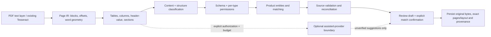

# Document AI: nâng cấp kiến trúc và kết quả kiểm chứng

Ngày thực hiện: 04/11/2026. Phát triển tiếp trên codebase hiện có; không thay tên API công khai, không tự duyệt HS, không gửi chứng từ ra dịch vụ AI bên ngoài.

**Phạm vi bằng chứng:** Có baseline đầu tác vụ, benchmark synthetic trước/sau, kiểm tra PDF thật, Chrome E2E, build React và regression tự động. **Chưa có holdout thực tế được gán nhãn độc lập, vì vậy chưa chứng minh được mức tăng độ chính xác trong vận hành thực tế.** Reserved synthetic không phải holdout mù.

## 1. Root causes đã xác minh

Baseline được giữ tại `scratch/document_ai_before/hs_assistant/`; các file `*_numbered.txt` giữ số dòng trước sửa. “Before” trong báo cáo là trạng thái đầu yêu cầu nâng cấp này, sau bản sửa an toàn demo trước đó.

| Lớp lỗi | Bằng chứng trước sửa | Hậu quả được tái hiện | Sửa tại |
|---|---|---|---|
| Text/OCR và layout | Baseline `extractor.py:141` trả text/method; `documents.py.process` có đường đọc PDF/OCR riêng. Layout, header và span không phải hợp đồng chung. | Text layer làm phẳng bảng; hai đường parse có thể khác khoảng trắng/vị trí. Commit lại parse tạo nguy cơ lệch source span. | `document_text.py:read_pdf_page`; `document_layout.py:build_layout`; `documents.py:_page`. Commit tái sử dụng đúng parse đã review và kiểm tra SHA256. |
| Table parsing | Baseline `product_extraction.py:62–67`: chỉ nhận bảng có SKU/model/part number, yêu cầu số cell mỗi dòng bằng header; khi có table thì bỏ nhánh section. | Header nhiều dòng, bảng không có mã model, dòng mô tả wrap và bảng cột giao dịch bị bỏ sót/đọc sai. | `document_layout.py:58 parse_tables`; `ensure_layout`; source row/header/page được giữ. |
| Field mapping | Baseline `product_extraction.py:76` chỉ map name và power/voltage/specifications. Baseline `extractor.py:382 _extract_dossier_document_fields` dùng nhóm regex giao dịch chung. | Thiếu quantity/unit/price/amount/origin; shipper bị map thành exporter, consignee thành importer; regex tên công ty có thể ăn sang địa chỉ. | `document_schema.py`; `extractor.py:288 extract_dossier_fields`; tách vai trò và quyền cung cấp từng trường. |
| Classification | Baseline `extractor.py:295` chấm điểm từ khóa; chưa có C/Q và không yêu cầu heading + cấu trúc. | Mention của từ catalogue có thể thành catalogue; chứng nhận chất lượng không có vai trò rõ. | `document_classification.py:33 classify_pages`: heading, schema fields/table structure, evidence theo trang, Unknown khi thiếu cơ sở. |
| Segmentation/matching | Baseline `product_extraction.py:84` dùng model làm khóa tuyệt đối hoặc document/page/index; `:101–104` đặc biệt thiên về các đơn vị điện/cơ bản. | Không ghép được hàng không có model; cùng mã nhưng khác thông số có thể bị gộp; thứ tự tên/model và dòng hàng có thể làm sai ranh giới. | `product_extraction.py:_section_spans`, `important_specs`, `_relation`, `extract`. Dùng explicit identifiers, measurement, quantity+unit và kiểm tra một–một; giữ riêng khi khác thông số/không chắc. |
| Reconciliation | Baseline `CrossDocumentReconciler.reconcile` chủ yếu so gross weight và công suất; gross weight lấy từ text gộp của document và ghi page=1. | Thiếu đối chiếu quantity/contract/origin/CQ; dẫn nhầm trang; không phân biệt thiếu dữ liệu với khớp. | `document_reconciliation.py:reconcile/check`: dùng records có nguồn, status missing/match/conflict/needs_review, không tự chọn giá trị mâu thuẫn. |
| Citation và user edits | Baseline `_validate_reviewed_sources` ràng buộc bằng `sku_code`; mutable draft cũng là nguồn để kiểm tra. | Sửa mã SKU của người dùng bị từ chối dù model nguồn còn nguyên; metadata layout có thể bị caller thay đổi. | `extractor.py:_canonical_drafts`, `_validate_reviewed_sources`, `_existing_match`. Chỉ value/review editable; nguồn được lấy lại từ snapshot server. Alias SKU không thay model nguồn. |
| Persistence/API/frontend | `Workspace.FIELDS` trước nâng cấp chỉ có các thuộc tính phân loại; draft metadata và row context không được lưu đầy đủ. `DraftCommitIn` đầu tác vụ chưa khai báo declaration_number. Frontend served và React source là hai đường riêng. | Transaction fields không tồn tại sau reload; payload field có thể bị schema bỏ qua; sửa served JS có thể mất sau build. | Migration additive, `fact_sources`, `case_extracted_fields`, `page_layouts`; API schema bổ sung; `frontend/public/assets/docfirst.js` là source được build sang web_dist; React và served review đều được sửa. |

### Bằng chứng trên Packing List thực tế

Dùng **cùng file gốc và cùng SHA256**, không chỉ nhìn demo:

- Before: 1 SKU nhưng **tên là `NAME OF GOODS QUANTITY`**, lấy nhầm header làm giá trị; không có quantity/unit/gross/net. Exporter/importer còn bị lẫn vai trò vận chuyển.
- After: 1 dòng hàng thực tế; quantity `2,000`, unit `BAGS`, net `50,000`, gross `50,200`, đơn vị cân nặng giữ từ header `KGM`, origin `India` từ statement trong đúng dòng sản phẩm. Mô tả ghép nhiều dòng được **đánh dấu needs_review**, không coi là đã xác minh.
- Metadata giữ shipper/consignee riêng; invoice number `73/INV/ST`. Consignee xuống dòng vẫn có thể thiếu phần tên tiếp theo; final destination không bị tự suy thành port of discharge.
- Đây là **case development đã dùng để thiết kế parser**, không phải holdout. Kết quả: `scratch/document_ai_real_packing_before.json` và `scratch/document_ai_real_packing_result.json`; đã đối chiếu ảnh render PDF.

## 2. Kiến trúc sau sửa và trade-offs

- Ưu tiên Poppler `pdftotext -layout` có sẵn; pypdf text layer làm fallback. Chỉ OCR khi không có text hoặc text hỏng rõ. Không so độ dài text để quyết định chất lượng nguồn.
- IR giữ document ID, page, char offsets (half-open Python character spans), blocks, rows/columns, header text và header source page. Word boxes chỉ lấy từ engine; text thuần không tự sinh bbox. Một header tiếp tục sang trang kế tiếp chỉ áp dụng trong cùng document và phải phù hợp cấu trúc; luôn cần rà soát.
- Deterministic parsing cho nhãn/định danh; table/layout parsing cho dòng hàng; validation cho quyền nguồn, quotes, số/đơn vị và identity. Không suy luận chất liệu/công dụng từ tên ngành hàng.
- Model/part/SKU rõ được ưu tiên. Measurement mâu thuẫn giữ thành variant riêng. Không có ID: chỉ ghép tự động khi nhiều tín hiệu và quan hệ một–một; nhiều ứng viên hoặc chỉ giống tên thì giữ riêng. UI có xác nhận cùng sản phẩm qua PATCH draft, có audit khi commit. Không cho ghép các cặp khác ID/thông số quan trọng bằng nút này.
- Trade-off: ưu tiên nguồn đúng hơn coverage. Bảng merged cells, multiline không rõ ranh giới hoặc free-text specification không so sánh được có thể cần người kiểm tra. Tên hàng và mã HS mâu thuẫn không được chọn ngầm.
- `assisted_extraction.py` cung cấp Protocol + policy, không có provider thật và không được gọi trong default pipeline. Cần enabled + allow_external_data + authorization theo request, page/token/cost budget. Output chỉ là suggestion unverified, phải qua nguồn và quyền field; không dùng để tự duyệt HS hay tự ghép SKU.
- Tesseract TSV là chế độ layout **opt-in**, vẫn cùng engine. Thử trên một scan English sạch tạo ra từ synthetic invoice: text thường nhận 0/2 row IDs qua table parser, TSV alignment nhận 2/2; cùng 19 word boxes. Đây chưa phải đánh giá OCR thực tế nên không bật toàn cục. Xem `scratch/ocr_layout_evaluation/results.json`.

## 3. Schema, provenance và lưu trữ

Hỗ trợ invoice number/date; seller/buyer; contract number; BL/AWB number; shipper/consignee; name/model/part; quantity/unit; unit price/amount/currency; gross/net/packages; origin; specifications/material/function; HS khai báo rõ. Invoice/packing/BL/CO/CQ/contract/datasheet/catalogue/declaration/legal/unknown có chính sách nguồn riêng.

Mỗi fact có value, field/field_name, source document/page/quote, extraction method, product ID, trạng thái nguồn và verification. Table facts bổ sung row/column/header/block/span. Values ghép từ multiline cells giữ value_fragments, không giả làm substring liên tục. Unit từ header giữ source_unit_quote. Trường thiếu vẫn thiếu; không mặc định origin/condition/HS.

Migration không rebuild DB: thêm `page_layouts`, `fact_sources`, `case_extracted_fields`; facts/cases cũ được giữ. Original bytes + SHA256 được lưu. Commit dùng lại parse đã review để nguồn không lệch khi parse/OCR lần hai. User edits giữ original_value và value_origin=user_input, không còn là dữ kiện document-extracted đã xác minh. SKU alias do người dùng đặt không thay model/part trong nguồn. Incremental apply bảo vệ mọi verified field và bỏ qua các source/value tuples đã có; metadata cũng không bị nhân đôi khi retry.

HS legal reference không cấp product facts, kể cả qua add_fact trực tiếp. HS khai báo có nguồn riêng, khác HS đề xuất; không có đường auto-approve. Conflict fields làm readiness cần rà soát.

## 4. Benchmark trước/sau trên cùng tập

Dữ liệu fixture: `tests/fixtures/document_ai/`. Có hash dataset, evaluator và table-cell labels trong kết quả JSON. Baseline source có hash riêng. **Các số dưới đây là synthetic author-labelled, trên các trường đã gán nhãn trong evaluation mask, không phải accuracy của toàn bộ chứng từ thực tế.**

| Tập | Cases / docs | Field precision trước → sau | Recall | F1 | SKU precision / recall trước → sau | Matching case exact trước → sau |
|---|---:|---:|---:|---:|---|---:|
| Development | 10 / 13 | 76.9% → 100% | 37.0% → 100% | 50.0% → 100% | 88.9% / 100% → 100% / 100% | 100% → 100% |
| Reserved synthetic | 5 / 7 | 80.0% → 100% | 22.2% → 100% | 34.8% → 100% | 100% / 33.3% → 100% / 100% | 80% → 100% |
| Adversarial development | 3 / 6 | 28.6% → 100% | 12.5% → 100% | 17.4% → 100% | 40.0% / 33.3% → 100% / 100% | 0% → 100% |

Bộ fixtures gồm thép, resin, thực phẩm, gỗ, textile, optics, pumps/control panels, fittings/valves/gears, chứng từ vận chuyển và legal/unknown negatives. 88 giá trị thuộc schema đánh giá được gán nhãn. Reserved cases được viết trước implementation nhưng cùng người thực hiện biết nội dung, nên **không độc lập hoặc mù**. Perfect scores trên tập nhỏ này không chứng minh production accuracy.

Các metric bổ sung trong `DOCUMENT_AI_BENCHMARK_RESULTS.json`:

- Classification: development 84.6% → 100%; reserved 85.7% → 100%; adversarial 100% → 100%.
- Identifier exact match: development 48% → 100%; reserved 28.6% → 100%. Adversarial IDs là gold entity labels, không được giả tính như model đã đọc đúng.
- Structured table row exact recall: development/reserved 0% → 100%. Before không trả row IR; precision trước là N/A (không có row objects), không phải khẳng định OCR trước không đọc được ký tự.
- Citation correctness bao gồm đúng document/page và entity membership; adversarial 33.3% → 100%, các tập còn lại 100% → 100%.
- Unsupported-value rate đo source grounding: 0% → 0% trong các fixtures. **Không thay thế human semantic hallucination assessment.** Coverage trên selected gold values bằng recall ở bảng.
- Matching ghi cả exact graph theo case và document/product membership Jaccard; không dùng độ giống tên làm accuracy.

### Ground truth thực tế

Đã xuất 10 document records, 8 SHA256 khác nhau vào `scratch/document_ai_real_annotation_queue.json`, toàn bộ **pending**, không có metric thực tế. Quy trình validator yêu cầu hai reviewer khác nhau, group/template/shipment split, source quotes hợp lệ; chặn cùng SHA/template/shipment ở hai split. Các PDF demo/legal/Packing List đã dùng để phát triển được ghi exposure manifest và không được đưa thành real holdout.

## 5. Kiểm thử và acceptance

- `scratch/document_ai_final_full_tests.txt`: **115 pass, 9 skip, 0 fail** trên full suite cuối cùng. Skips do thiếu model artifacts/rank_bm25, không được tính pass.
- `scratch/document_ai_generalization_tests.txt`: **42 pass**, tests extraction/API liên quan trên code cuối; gồm multi-industry schema, header/wrap/continuation, quantity/unit, alias, ambiguity, variant conflicts, legal permissions, Unicode/source, user edits, AI guards, migration, idempotence, explicit page limit và save/load.
- `scratch/document_ai_frontend_tests.txt`: 2 frontend format tests pass. `scratch/document_ai_react_build.txt`: Vite production build pass; served assets được tạo lại, file source của review script nằm trong frontend/public để lần build sau không mất sửa.
- `scratch/document_ai_browser_e2e_result.json`: **Chrome E2E pass** trên rebuilt served frontend: upload hai PDF gốc → review → commit → API load → browser reload; không có page errors. Database kiểm thử riêng dưới /tmp, không tạo case kiểm thử vào workspace người dùng.
- `DOCUMENT_AI_ORIGINAL_DEMO_RESULT.json`: đọc lại **hai PDF gốc**, đủ 105 trang (2 kỹ thuật + 103 legal), đúng 2 SKU và power/page, không lấy HS/số tờ khai từ law. PDF kỹ thuật đã có lại trong workspace nên không còn giới hạn dùng text cache của lần trước. Trang blank/OCR cần xem lại được giữ và báo rõ.

## 6. Lỗi/giới hạn còn lại

1. Chưa có independently reviewed real holdout. Chưa thể công bố tăng độ chính xác thực tế hoặc tỷ lệ hallucination do chuyên gia đánh giá.
2. Layout parser chưa giải quyết mọi merged cell, cột lệch, ảnh mờ/xoay hoặc chữ viết tay. Continued/wrapped rows cần rà soát, không tự verified.
3. Party name nhiều dòng có thể còn thiếu continuation. Trong Packing List thực tế, consignee mới lấy được dòng tên đầu; không ghép tiếp địa chỉ để làm tên.
4. Composite invoice number/date kiểu `No. & Date of Invoice` mới bảo toàn số invoice; ngày dạng chữ/tháng hoặc locale không chắc có thể để trống. Không dùng ngày hiện tại thay ngày chứng từ.
5. Numeric locale/đơn vị không rõ không được tự diễn giải thành kg/USD/PCS; chênh lệch có dấu phân cách mơ hồ cần xác nhận.
6. Matching thiếu ID/spec/quantity không đủ cơ sở phải người dùng xác nhận. Free-text specification chưa có semantic model để hiểu tương đương/mâu thuẫn mọi ngành.
7. Vision/LLM provider thật chưa được tích hợp hoặc đánh giá. Mock tests chỉ kiểm tra policy/citation/cost gates, không phải chất lượng model.
8. Draft review vẫn dùng bộ nhớ như workflow hiện có; restart server trước khi commit có thể làm mất bản nháp. Case đã commit, pages/layout và provenance được lưu DB.
9. Đây là parser bảo thủ và framework benchmark/annotation, chưa phải tuyên bố hỗ trợ hoàn hảo mọi mẫu chứng từ.

Hướng dẫn vận hành, cấu hình, tái chạy benchmark và quy trình review: `DOCUMENT_AI_OPERATIONS.md`.
