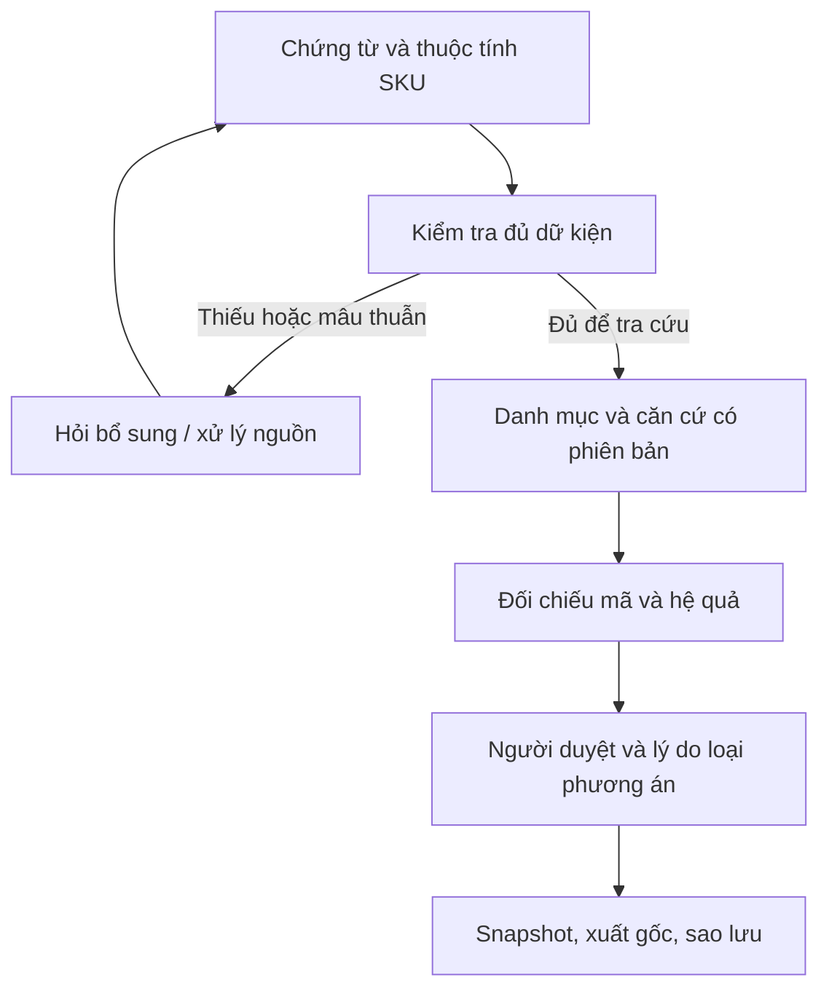

# HSCode_AIProject — Independent Multidisciplinary AI Project Review

**Ngày đối chiếu:** 02/11/2026, múi giờ Việt Nam. **Đối tượng:** dự án trên Drive và gói `hs-assistant-app.zip` bản 2.1.0; bản sửa ứng dụng 2.2.0. Đây là phản biện theo chín chuyên môn, không phải quyết định phân loại hoặc chứng nhận của cơ quan Hải quan.

## 1. Kết luận để nhóm quyết định

**Giữ hướng hỗ trợ quyết định và lưu bằng chứng. Bản gốc chưa hoàn thành ba trụ cột theo định hướng mới; bản 2.2 bổ sung các phần nghiệp vụ có thể kiểm thử, nhưng vẫn là prototype cho pilot có giám sát.** Chưa đủ bằng chứng về độ đúng phân loại trong vận hành, hiệu quả sau người duyệt, willingness-to-pay hoặc ưu thế so với sản phẩm đang có.

Điểm mạnh có thể phát triển là tái hiện **SKU nào, dữ kiện nào, các mã nào đã cân nhắc, căn cứ nào được dùng/loại, ai lập/duyệt, theo phiên bản nguồn nào**. Giá trị này phải được đo bằng thời gian và chất lượng quyết định cuối cùng. Đổi giao diện hoặc thêm một LLM không chứng minh tăng accuracy, giảm truy thu hay có lợi thế cạnh tranh bền vững.

Phán quyết theo mục đích:

| Mục đích | Đánh giá |
|---|---|
| Demo đồ án về quy trình có kiểm soát | Có cơ sở triển khai với dữ liệu mẫu và giới hạn được trình bày rõ |
| Pilot nội bộ, người nghiệp vụ kiểm tra từng quyết định | Có điều kiện: kiểm tra nguồn, tài liệu kỹ thuật, bảo mật và khả năng phục hồi trước khi dùng ca thật |
| Tự động chọn mã để khai báo | Chưa đạt; tiếp tục tắt |
| Tuyên bố phương pháp mới đạt chuẩn Q1 hoặc HS8 >80% | Chưa có bằng chứng |
| Bán dịch vụ bảo đảm thuế/pháp lý chính xác | Chưa đạt |

## 2. Phạm vi và mức độ kiểm chứng

Đã truy cập đúng thư mục `HSCode_AIProject`; tìm kiếm không thấy tệp mang tên chính xác `hs-code-assistant.zip`. Mã nguồn được kiểm tra là tệp `hs-assistant-app.zip` trong thư mục đó, modified time nhận được 01/11/2026 17:04:59 UTC.

Đã lấy nội dung báo cáo, task assignment, hướng dẫn và bản bàn giao V5 hiện tại; đọc mã và đầu ra của bảy notebook, các module pipeline, bảng chọn model, dự đoán từng hồ sơ, bảng kiểm định và artefact đánh giá. Có 204 tệp nguồn/đầu ra được đưa vào đối chiếu cục bộ, ngoài hai tài liệu gốc đã đọc trực tiếp. Kiểm kê thấy 2.407 mục, gồm 961 PDF trong `raw_pdf` và 967 bản TXT OCR; các thư mục cache OCR/trọng số không được diễn giải như tài liệu nghiệp vụ độc lập.

**Không coi việc kiểm kê là đã đọc độc lập mọi bản scan.** Không OCR lại toàn bộ PDF gốc, không chạy lại GPU/paid API, không tái huấn luyện toàn chuỗi 01–07. Kết quả model trong báo cáo này được tính lại từ dự đoán đã lưu, không phải inference mới. Workbook 39 sheet được đọc lại. DOCX SEN chứa 414 hình và nhiều bảng; trích xuất văn bản không xác nhận đã đọc hết nội dung ảnh. Tính áp dụng pháp lý của mỗi thông báo vẫn cần kiểm tra bản gốc và chuyên gia.

Các nguồn nội bộ quan trọng: `vn_raw.jsonl`, `vn_clean.jsonl`, `predictions.json`, `predictions_final.json`, `model_selection_matrix.csv`, `ket_qua_chinh.csv`, `kiem_dinh_holm.csv`, `Multilevel_V5_Actual_Run.zip`, `SOURCE_COVERAGE.json`, `README_PIPELINE_V5.md`, `[HSCode V5] Kết quả thực nghiệm, bản bàn giao và việc còn lại 2026-11-01`.

## 3. Workflow XNK và các quyết định thực sự cần hỗ trợ

| Thời điểm | Người ra quyết định | Dữ kiện cần có | Đầu ra sản phẩm nên cung cấp |
|---|---|---|---|
| Nhận hàng/SKU mới, trước khi cam kết lịch nhập | Nhân viên XNK, kỹ thuật, người phụ trách tuân thủ | Công dụng thiết kế, cấu tạo, thành phần, trạng thái, quy trình sản xuất, thông số, model và tài liệu đúng SKU | Các phạm vi cần xem, thuộc tính phân biệt, tài liệu còn thiếu, nguồn có thể kiểm tra |
| Phân vân giữa các mã | Người lập và người duyệt; có thể phối hợp đại lý | Cùng dữ kiện hàng; chú giải/GRI; ngày và phiên bản; hệ quả thuế/chính sách của từng phương án | Bảng đối chiếu điều kiện và hệ quả, lý do giữ/loại, vấn đề phải hỏi lại |
| Cân nhắc xác định trước | Chủ hàng và người phụ trách lịch hàng/tuân thủ | Hồ sơ kỹ thuật đủ, điểm tranh chấp còn lại, thời điểm dự kiến nhập | Checklist chuẩn bị và lý do chuyển chuyên gia/cân nhắc thủ tục; không hứa thời hạn giải quyết bằng số trung vị nội bộ |
| Khai và thông quan | Người khai, chủ hàng/đại lý trong phạm vi trách nhiệm | HS đã đối chiếu; trị giá, xuất xứ, chứng từ, giấy phép/kiểm tra, luồng XNK và chế độ thuế | Hồ sơ phân loại có người duyệt; các điều kiện ngoài HS còn phải xử lý |
| Sau thông quan hoặc khi nguồn thay đổi | Chủ hàng, kế toán, tuân thủ | Tờ khai, tài liệu kỹ thuật đúng lô, quyết định/căn cứ tại thời điểm trước, thay đổi hàng/văn bản | Tái dựng quyết định cũ; hàng đợi rà soát; lưu thay đổi có lý do |

HS chỉ là một phần của hồ sơ nhập khẩu. Trị giá phụ thuộc phương pháp và khoản điều chỉnh; ưu đãi phụ thuộc xuất xứ và điều kiện hiệp định; chính sách chuyên ngành còn phụ thuộc bản chất hàng, phạm vi, mục đích, trạng thái và thời điểm. Không thể suy ra toàn bộ nghĩa vụ chỉ từ một chuỗi HS8. Invoice có thể thiếu dữ kiện quyết định. Mã từng thông quan hoặc được doanh nghiệp dùng nhiều lần không tự trở thành ground truth.

## 4. Đối chiếu pháp lý Việt Nam

| Nội dung | Kết luận đã đối chiếu | Hệ quả thiết kế |
|---|---|---|
| NĐ128/2020 và NĐ169/2026 | NĐ169 ban hành 15/05/2026, hiệu lực 01/07/2026; nguồn Bộ Tài chính xác nhận NĐ128 và phần sửa đổi liên quan hết hiệu lực từ thời điểm đó [L1–L2] | Lưu văn bản theo thời kỳ, giữ căn cứ lịch sử và kiểm tra quy định chuyển tiếp; không dùng NĐ128 như căn cứ hiện hành chung |
| Luật 11/2026/QH16 | Đã ban hành 23/08/2026 nhưng hiệu lực 01/03/2027 [L3] | Chưa áp dụng sớm sửa đổi Điều 77 vào 02/11/2026 |
| Mốc 5 năm | Điều 18(2)(đ) và Điều 77(3) trong bản hợp nhất 54/VBHN-VPQH ngày 23/03/2026 quy định mốc từ ngày đăng ký tờ khai [L4] | Ghi riêng ngày đăng ký, không dùng ngày tạo case hoặc ngày AI phân tích |
| Thời hiệu và nghĩa vụ thuế | Bản ký NĐ169, Điều 5, trang 4: cần phân biệt thời hiệu xử phạt và việc nộp đủ thuế/tiền chậm nộp; có quy định về thời gian 10 năm trở về trước khi phát hiện trong trường hợp nêu tại điều này [L1] | Không hứa hết mọi rủi ro sau 5 năm; không tự xóa; để nghĩa vụ lưu và tranh chấp được xử lý riêng |
| TT85/2026 và TT121/2025 | Registry/bản ký của dự án được giữ để đối chiếu; TT85 có hiệu lực 15/09/2026, thay TT14/2015 và TT17/2021 [L5] | Quy định quy trình không được dùng làm nhãn đúng cho một SKU; bản ký không tự chứng minh mọi sửa đổi về sau đã được cập nhật |

Hồ sơ nội bộ có thể hỗ trợ việc chuẩn bị giải trình. Việc cơ quan có thẩm quyền chấp nhận căn cứ, kết luận phân loại hay xử lý thuế không được tạo ra chỉ bằng một nút duyệt trong ứng dụng. Bản 2.2 thể hiện đúng giới hạn này.

## 5. Kiểm toán dữ liệu và ground truth

| Quan sát từ dữ liệu hiện có | Ý nghĩa |
|---|---|
| 967 bản ghi raw; 798 clean; train 580 / valid 109 / test 109 | Phải nêu tiêu chí loại 169 bản ghi, không gọi 967 là số nhãn đã thẩm định |
| 719 nhãn nguồn OCR, 79 nhãn `nhap_tay`; 8 dòng gắn `ma_sua_ocr` | Cần đối chiếu provenance và bản gốc. Các cờ này không chứng minh nhãn sai, cũng không chứng nhận nhãn đúng |
| Train đến 21/04/2025; valid 25/04–17/12/2025; test 29/12/2025–21/09/2026 | Chia theo thời gian có giá trị, nhưng test đã được xem trong phát triển nên không còn là xác nhận độc lập |
| 57/109 nhãn test chưa có trong train; M0 đúng 0/57 | Không dùng kết quả seen-only để đại diện hàng mới; phải kiểm tra retrieval và unseen-label performance |
| 24/109 test thuộc doanh nghiệp đã thấy trong train; 11 mã nhóm doanh nghiệp giao giữa train/test | Chưa tự chứng minh trùng SKU; cần kiểm tra họ sản phẩm, model, nguồn thay thế và near-duplicate. Tập chặt cũ còn 84 mẫu |
| 961 PDF trực tiếp so với 967 tên nguồn trong raw | Sáu tên chưa tìm thấy trong danh sách thư mục PDF trực tiếp; chưa thể kết luận thất lạc trên toàn Drive. 793/798 clean có link khớp tên từ danh sách đó |
| SOURCE_COVERAGE V5: 409 tài liệu duy nhất, 4.337 đơn vị, 1.804 đơn vị còn chờ OCR; expert gold mới = 0 | Kho tài liệu lớn hơn không đồng nghĩa đã hoàn tất trích xuất hay có thêm nhãn đúng. Khoảng 41,6% đơn vị còn pending theo manifest này |

Sáu tên cần nối lại provenance: `4796_TB-TCHQ_2022-11-11.pdf`, `4903_TB-TCHQ_2022-11-18.pdf`, `4904_TB-TCHQ_2022-11-18.pdf`, `5420_TB-TCHQ_2022-12-14.pdf`, `5421_TB-TCHQ_2022-12-14.pdf`, `5437_TCHQ_2022_12_15.pdf`.

Tách rõ năm loại dữ liệu: **mã quan sát trên chứng từ**, **mã AI đề xuất**, **mã người dùng duyệt nội bộ**, **kết luận có nguồn và phạm vi cụ thể**, **nhãn nghiên cứu được thẩm định độc lập**. Không tự chuyển loại trước sang loại sau. Với hàng nhiều model hoặc nhiều dòng, đơn vị gán nhãn phải là đúng SKU/cấu hình và thời điểm tương ứng.

## 6. Tính lại kết quả và sửa cách diễn giải

### 6.1. Chất lượng HS8 chưa được cải thiện bằng stack cũ

| Cấu hình lịch sử | HS8 Top-1 | Wilson CI 95% | Diễn giải |
|---|---:|---:|---|
| M0 | 32/109 = 29,36% | 21,63–38,49% | Đối chứng cần giữ |
| Stack M0 + M5a + L1 | 27/109 = 24,77% | 17,62–33,64% | Chưa chứng minh tốt hơn M0; số đúng thấp hơn |

Bảng kiểm định lưu cho HS8 có 9 ca stack đúng/M0 sai và 14 ca ngược lại; McNemar p≈0,405, Holm p=1,0 trong family đã báo. Kết quả này không chứng minh hai model tương đương; nó không cung cấp bằng chứng về ưu thế của stack. Test đã được xem nhiều lần nên các p-value nên được trình bày như phân tích lịch sử/khám phá.

Lần chạy V5 lưu 16 cấu hình, gồm M0 và 15 đối chứng; gate chọn trên VALID giữ M0. Không lấy một bảng cũ gọi model cuối là lựa chọn vận hành mới. Không có inference mới để chuyển bất kỳ tỷ lệ này thành accuracy của app 2.2.

### 6.2. Vì sao Top-3 HS4 đang có nhiều số

Tính lại từ `predictions_final.json` trên đúng 109 nhãn:

| Định nghĩa | Số đúng | Tỷ lệ |
|---|---:|---:|
| Ba nhóm HS4 được xếp riêng trong trường `heads` | 84/109 | 77,06% |
| Ba nhóm khác nhau lấy theo thứ tự từ danh sách HS8 xuất ra | 83/109 | 76,15% |
| Tiền tố HS4 của ba mã HS8 đầu tiên | 65/109 | 59,63% |

Ba tỷ lệ có thể cùng đúng vì khác đơn vị xếp hạng; ba mã HS8 có thể thuộc cùng một nhóm. Cần ghi metric, trường dự đoán và cohort thay vì dùng chung tên “Top-3”. UI 2.2 ghi rõ các nhóm là tiền tố khác nhau của danh sách truy hồi; không gắn 77,1% lịch sử lên UI đó.

### 6.3. Các con số khác cần giữ đúng phạm vi

- **59 ngày:** tính lại trên 243 clean có hai ngày hợp lệ cho trung vị 59, IQR 36,5–84. Đây là khoảng từ ngày đơn được OCR ghi nhận đến ngày thông báo trong mẫu thành công; không phải SLA, thời gian kể từ đủ hồ sơ hay so sánh trực tiếp với vài phút tìm ứng viên.
- **40% lỗi bỏ sót chính sách:** là phân tích từ bảng chính sách/nhãn lịch sử của nhóm. Chưa phải tỷ lệ vi phạm được chuyên gia xác nhận hoặc tỷ lệ trên toàn doanh nghiệp Việt Nam. Không dùng làm xác suất gây thiệt hại trong ROI.
- **80% conformal:** bảng cũ có mức mục tiêu 90% nhưng thực nghiệm chỉ 82,57% và tập trung bình 10 nhóm. Mức 80% có 80,73% quan sát không tạo ra cam kết cho khách mới. Cần tách calibration, kiểm tra exchangeability/drift, pool và full-label support [R7–R8].
- **Ca khó:** thiết kế lấy từ đơn xin xác định trước có selection bias. Không thể suy ra đây là cận dưới chắc chắn của accuracy trên hàng thông thường; dữ liệu doanh nghiệp có thể thiếu thuộc tính theo cách khác.

Nếu tập dự đoán C(x) chỉ nằm trong pool K(x), thì:

\[P\{Y\in C(X)\}\leq P\{Y\in K(X)\}.\]

Recall@200 của pool M0 lịch sử là 77,98%. Xếp hạng lại pool đó không cứu được nhãn nằm ngoài pool. Con số này là giới hạn của pool/cấu hình/cohort cụ thể, không phải trần cho mọi phương pháp.

## 7. Đánh giá theo chín chuyên môn

| Góc nhìn | Nhận định | Việc cần làm để kết luận mạnh hơn |
|---|---|---|
| Nghiệp vụ XNK/Hải quan | Đi đúng điểm thiếu thuộc tính và khó tái dựng quyết định. Luồng HS chưa bao phủ trị giá, xuất xứ, giấy phép và vận hành khai báo | Quan sát hồ sơ thật từ tiếp nhận thông tin đến lưu sau thông quan; phân biệt ai lập, ai chốt, ai chịu trách nhiệm |
| Vietnam compliance | Có nhu cầu version/date thật; diễn giải “5 năm” và luật tương lai cần sửa | Duy trì registry có người phụ trách; kiểm tra bản gốc, văn bản thay thế, phạm vi và chuyển tiếp theo giao dịch |
| AI research reviewer | Retrieval + giải thích + human review đã có tiền lệ nghiên cứu; novelty phương pháp chưa chứng minh [R1–R4] | Chốt RQ hẹp về chất lượng quyết định, thu thập thuộc tính hoặc benchmark Việt Nam có provenance; không gọi engineering là thuật toán mới |
| AI/ML/RAG architect | Chưa có bằng chứng đổi sang model phức tạp tạo lợi ích. Từ chối có thể theo quy tắc khi thiếu dữ kiện; điểm model hiện chưa hiệu chuẩn | Giữ baseline rẻ; tách candidate recall, ranking và dữ kiện đầu vào; chỉ thêm dense/LLM sau khi chứng minh gain trên VALID |
| Product strategy | Hướng hồ sơ có thể có giá trị nhưng moat/ROI/adoption chưa xác nhận. Đối thủ cũng công bố căn cứ, hỏi lại và công cụ danh mục [M1–M3] | Thử công việc đầy đủ với người dùng và công cụ hiện có; tìm khách có ca mới/ca tranh chấp thường xuyên, đo willingness-to-pay |
| Methodology | Có temporal split và các guard tiến bộ; test cũ không còn độc lập, đơn vị sản phẩm/nhà sản xuất cần chặn leakage | Freeze giao thức, tách train/selection/calibration/future-test theo thời gian và nhóm; dùng paired evaluation và uncertainty phù hợp |
| Ground truth audit | Văn bản đúng nguồn chưa đủ nếu OCR sai vai trò mã hoặc không đúng SKU. Nhãn chuyên gia độc lập còn thiếu | Hai người phân loại độc lập, hồ sơ kỹ thuật, adjudication, source hashes và label version; giữ cả ca thiếu thông tin |
| Red team | False confidence có thể đến từ giao diện xanh, điểm retrieval, nguồn trích đúng nhưng sai phạm vi, hoặc chỉ bỏ chọn nguồn mâu thuẫn | Kiểm thử điều khoản loại trừ, đơn vị, ranh giới, thay đổi revision, nguồn bị hủy, nguồn tương lai, thiếu pool, prompt injection và sửa dữ liệu |
| Responsible AI/governance | Người duyệt tự khai và hash nội bộ chưa tạo accountability có xác minh danh tính hoặc lưu bền vững | Pilot local, phân quyền/danh tính trước triển khai thật, tối thiểu hóa gửi dữ liệu, backup/restore, quản lý quyền corpus và nhật ký có neo độc lập |

## 8. Nghiên cứu được dùng và giới hạn chuyển giao

Không gắn nhãn Q1/Q2 tùy tiện: quartile cần đúng hệ JCR/SJR, ngành và năm; hội nghị ACL/EMNLP không được gọi là tạp chí Q1 chỉ vì có uy tín. Bảng dưới ghi nơi xuất bản và loại bằng chứng để nhóm dẫn đúng.

| Nguồn | Loại bằng chứng | Áp dụng cho dự án |
|---|---|---|
| Lee et al., *Explainable Product Classification for Customs*, ACM TIST 2024, DOI 10.1145/3635158; bản tác giả arXiv 2311.10922 [R1] | Nghiên cứu với Korea Customs Service; gợi ý HS6, retrieval bằng chứng và user study | Đọc cách đánh giá người dùng; không lấy accuracy HS6 Hàn Quốc làm mục tiêu/accuracy VN8. Hướng hỗ trợ giải thích không mới tự thân |
| Lan et al., *HSCodeComp*, ACL 2026, DOI 10.18653/v1/2026.acl-long.937 [R2] | Benchmark 632 sản phẩm, 26 chuyên gia; agent tốt nhất 46,8% so với 95% chuyên gia trong bài | Nhấn mạnh kiểm định quy tắc phân cấp và sai ở mã đầy đủ; benchmark 10 số khác phạm vi Việt Nam |
| Nguyen et al., *Consensus-based Agentic LLM Framework…*, arXiv 2606.16987, 2026 [R3] | Bản tác giả về Canadian HTS10, dữ liệu riêng 3.300 bản ghi | Có retrieval, confidence và human escalation từ trước; không tuyên bố hệ thống Việt Nam đầu tiên trên thế giới. Không coi preprint/metadata là bằng chứng Q1 |
| Qi et al., *Attribute knowledge and KBGAT…*, Scientific Reports 2025, DOI 10.1038/s41598-025-16580-7 [R4] | Bài tạp chí về graph thuộc tính; code công bố, dữ liệu theo yêu cầu | Gợi ý khai thác thuộc tính, không đủ để chọn GNN trên corpus nhỏ hoặc chuyển accuracy qua quốc gia |
| Fisman & Wei, JPE 2004, DOI 10.1086/381476 [R5] | Bằng chứng kinh tế về khai sai nhóm và thuế trên thương mại Hong Kong–China | Hợp lý để xem chênh lệch thuế; không chứng minh doanh nghiệp Việt Nam cụ thể có xác suất bị soi cao nhất |
| Buçinca et al., PACM HCI/CSCW 2021, DOI 10.1145/3449287 [R6] | Thí nghiệm cognitive forcing; có trade-off với đánh giá chủ quan của người dùng | Cơ sở cho thiết kế nêu lý do loại phương án khác; hiệu quả giảm overreliance của app này vẫn phải đo |
| El-Yaniv & Wiener, JMLR 2010 [R7] | Nền tảng selective classification và risk–coverage | Báo đồng thời tỷ lệ trả lời và lỗi trong phần trả lời; không báo riêng accuracy của tập ca dễ |
| Barber et al., Annals of Statistics 2023, DOI 10.1214/23-AOS2276 [R8] | Điều kiện và giới hạn conformal khi dữ liệu không exchangeable | Không chuyển một tỷ lệ coverage quan sát thành bảo đảm cho nguồn/giai đoạn mới |
| Gao et al., ALCE, EMNLP 2023, DOI 10.18653/v1/2023.emnlp-main.398 [R9] | Đánh giá correctness và citation quality | Đúng đoạn trích mới là một lớp; phải chấm việc nguồn hỗ trợ kết luận và có đủ căn cứ cho claim |
| NIST AI 600-1, 2024, trang cập nhật 2026 [R10] | Khung quản trị rủi ro AI tự nguyện | Dùng để tổ chức đo lường/giám sát, không thay pháp luật Việt Nam |

### Phản biện hai lập luận trong định hướng

Fisman–Wei nghiên cứu hành vi kê khai ở mức thương mại và thuế suất, không xây model chọn hồ sơ kiểm tra cho Hải quan Việt Nam. Sản phẩm nên gọi đầu ra là **chênh lệch nghĩa vụ theo kịch bản và phần còn thiếu căn cứ**. Chưa có dữ liệu để gán xác suất bị kiểm tra hay expected penalty.

Buçinca cung cấp động cơ thiết kế, không chứng minh rằng checklist dài hoặc ô lý do 20 ký tự trong app sẽ giảm sai. Cần đo người dùng có phát hiện và sửa gợi ý AI sai hay chỉ điền đủ ô để bấm duyệt.

## 9. Ma trận tính năng: bản gốc và bản sửa

| Tính năng | Bản 2.1 thực tế | Bản 2.2 | Mức kết luận |
|---|---|---|---|
| Hồ sơ nhiều SKU, OCR theo trang, thuộc tính có nguồn | Đã có | Giữ và chặn thêm đường nâng fact thiếu nguồn thành verified | Kiểm thử phần mềm; chưa benchmark OCR toàn corpus |
| So sánh danh mục các mã | Có bảng mô tả, chưa phải bảng hệ quả lưu theo hồ sơ | Có so sánh 2–3 mã, cùng trị giá/ngày/luồng, giữ unknown; lưu revision + analysis ID | Đã kiểm thử phép tính/guard; chính sách do người dùng đối chiếu |
| Thuế/FTA | Có snapshot và kịch bản | Giữ điều kiện; so sánh không tự dùng mức thấp nhất; Chương 98 tách riêng | Chưa xác minh mọi mức thuế hiện hành |
| Ba nhóm và căn cứ Việt Nam | Model/knowledge tùy cấu hình, chưa gắn rõ vào luồng mặc định | Nhóm khác nhau được ghi rõ định nghĩa; 798 bản trích, mặc định train-only, lọc ngày và trạng thái dự án; link bản nguồn nếu có | Truy hồi không chứng minh áp dụng pháp lý |
| Từ chối và hỏi lại | Có missing facts/LLM schema | Thêm trạng thái `needs_information`, `model_abstained_retrieval_only`; không trình BM25 như model chấp thuận | Chưa có calibration/coverage mới |
| Người duyệt và lý do | Có hai tên và lý do chung | Yêu cầu mã khác, lý do loại, xác nhận căn cứ độc lập lợi ích thuế; nguồn phải gắn mã/phạm vi | Kiểm tra cấu trúc; chưa xác minh danh tính hoặc đúng ngữ nghĩa |
| Mâu thuẫn nguồn | Có thể bỏ chọn nguồn conflict để qua gate | Còn bất kỳ conflict nào thì chặn; có thao tác cập nhật vai trò/hiệu lực kèm lý do và nhật ký | Đã kiểm thử |
| Bản chụp quyết định | Chưa đóng băng đầy đủ tại lúc duyệt | Snapshot dữ kiện, lựa chọn/loại trừ, phân tích, đoạn trích, tài liệu, registry/hash và so sánh phù hợp revision | Không phải chữ ký số; nguồn URL-only được chỉ rõ thiếu bản gốc |
| Xuất hồ sơ | PDF/XLSX/JSON | Thêm ZIP gốc + JSON + nguồn chính thức đóng gói + manifest; kiểm hash, chặn file thiếu/sai | Không tự bảo đảm lưu 5 năm; cần sao lưu/restore |
| Mốc lưu và legal hold | Chưa có ngày đăng ký riêng | Thêm số/ngày tờ khai, mốc 5 năm, cờ tiếp tục giữ; không tự xóa | Mốc tham chiếu, không kết luận hết nghĩa vụ khác |
| Văn bản thay đổi | Registry rời | Thêm màn hình trạng thái theo ngày, phân biệt Luật 11 chưa hiệu lực | Chưa tự theo dõi mọi văn bản hoặc push alert cho danh mục khách hàng |
| Bộ nhớ mã đã khai | Chưa có cơ chế knowledge chuyên biệt | Quyết định/snapshot vẫn được giữ; không tự dùng lại như gold | Còn backlog cho quyết định tái sử dụng có điều kiện |
| SSO/RBAC/tenant isolation/chữ ký số | Chưa có | Chưa có | Chặn mục tiêu SaaS nhiều doanh nghiệp trước khi hoàn thiện |

Lõi conformal cũ cũng được sửa lấy đúng order statistic `ceil((n+1)(1-alpha))` cho nonconformity score trong [0,1], thay cách gọi quantile có thể lệch một thứ hạng. Đây là sửa hàm/guard, không tái hiệu chuẩn model đã lưu hay phát hành bảo đảm coverage.

## 10. Kiến trúc nên giữ đơn giản

Phần kiểm tra dữ kiện, lifecycle, ngày, phiên bản, FTA, tính toán và lưu vết nên deterministic. BM25/char TF-IDF là baseline; dense/LLM chỉ thêm khi tăng recall hoặc chất lượng quyết định trên tập lựa chọn đã chốt. LLM không có vai trò tự xác nhận nguồn do chính nó sinh hoặc tự sửa nhãn theo mã gần nhất.

Tách ba mức: **truy hồi được nguồn**, **nguồn có hỗ trợ một nhận định**, **nguồn áp dụng cho đúng SKU và ngày**. Kiểm tra nguyên văn chỉ giải quyết một phần mức thứ nhất; chưa chứng minh hai mức sau. Không dùng số truy hồi để tính expected loss khi chưa có xác suất sai đã hiệu chuẩn và cost model được xác minh.

## 11. Evaluation khả thi và có giá trị nghiên cứu

### 11.1. Thiết kế dữ liệu

Đóng băng train/selection/calibration/future-test trước khi mở nhãn test mới. Group theo SKU/model/họ sản phẩm, nhà sản xuất, tài liệu gốc, bản dịch và chuỗi sửa/hủy; thời gian lấy theo lúc căn cứ thực sự có thể được biết. Nhãn được hai người phân loại độc lập trên hồ sơ đủ; bất đồng được adjudicate và ghi lý do. Giữ cả nhãn chưa xác định, không loại ca khó khỏi mẫu mà không báo.

Baseline tối thiểu: quy trình hiện tại của người dùng; workflow có cấu trúc nhưng không LLM; BM25/char TF-IDF; M0; cùng hệ thống có LLM. Cố định corpus, nguồn được truy cập, đầu vào và budget để phân biệt gain do thông tin tốt hơn với gain do model.

### 11.2. Outcome theo quyết định người dùng

| Thành phần | Đo gì |
|---|---|
| Retrieval | Recall@K theo HS4/6/8, seen/unseen, chương, độ đầy đủ đầu vào; tính cả retrieval miss |
| Classification | HS2/4/6/8 Top-1; định nghĩa Top-k rõ; macro F1; paired difference và CI |
| Abstention | Answer coverage, selective risk, AURC; hiệu chuẩn trên cohort riêng; tỷ lệ chuyển chuyên gia và thời gian hỏi bổ sung |
| Citation | Citation precision/recall, entailment được chuyên gia chấm, đúng vai trò supports/excludes, đúng phiên bản/ngày, nguồn hủy và mâu thuẫn |
| Human-in-the-loop | Mã cuối sau duyệt, tỷ lệ người dùng sửa gợi ý AI sai, lỗi giấy phép bị bỏ sót, thời gian hoàn tất, tải nhận thức |
| Auditability | Người khác có tái dựng được quyết định và tìm đúng bản gốc không; completeness và thời gian tìm hồ sơ |
| Operations | Chi phí OCR/inference/duyệt/bảo trì nguồn, lỗi xử lý tài liệu, khả năng phục hồi và quyền truy cập |

Các hypothesis có ý nghĩa: workflow bằng chứng giảm thời gian tái dựng hồ sơ; câu hỏi thuộc tính phân biệt cải thiện chất lượng quyết định ở cùng nguồn; đối chiếu hệ quả giảm bỏ sót yêu cầu chính sách sau người duyệt. Chúng là giả thuyết, chưa phải kết quả.

Trong pilot nghiên cứu, cân bằng thứ tự công cụ và nhóm hàng; tránh cho cùng người xử lý lặp lại cùng một case ở nhiều điều kiện mà không kiểm soát learning effect. Có thể dùng Latin square/matched cases. Phân tích phải tính clustering theo người và họ sản phẩm, không coi hàng trăm lượt xử lý lặp là hàng trăm mẫu độc lập. Chốt outcome chính, correction cho nhiều phép thử và kế hoạch cỡ mẫu theo effect thực tế. Phỏng vấn ít người giúp phát hiện vấn đề UX, không đủ chứng minh accuracy hoặc ROI tổng thể.

### 11.3. ROI

\[\text{Lợi ích ròng/năm}=N(t_0-t_1)c_h-\text{phí sản phẩm}-\text{công kiểm tra thêm}-\text{lưu trữ/bảo trì}.\]

Thời gian `t1` phải gồm đọc nguồn, hỏi kỹ thuật và duyệt; không chỉ thời gian API. Không đưa “tiền phạt tránh được” vào kịch bản cơ sở nếu chưa đo được lỗi và quan hệ nhân quả. Bảng ROI nội bộ hiện có kịch bản cơ sở khoảng −2,43%; mốc khách hàng khoảng 340 hàng mới/năm là kết quả phụ thuộc giả định cũ, chưa phải tiêu chí thị trường đã xác minh.

## 12. Định vị và lợi thế cạnh tranh

Nguồn chính chủ Avenir hiện tự công bố tra cứu HS, thuế/FTA, căn cứ GRI/chú giải và hỏi làm rõ; HSCodeVN hiển thị thay đổi thuế/chính sách; trang `hscode.pro.vn` công bố tra mã, chú giải và biểu thuế [M1–M3]. Đây là bằng chứng về chức năng được giới thiệu, không xác minh chất lượng hay feature trả phí đầy đủ. Chưa xác minh được chính xác sản phẩm mang tên HSCodePro qua tìm kiếm hiện tại; không đồng nhất mọi tên/domain gần nhau.

Vì vậy không nên nói “chưa ai có căn cứ”, “chưa ai hỏi lại”, hoặc “chỉ nhóm có hồ sơ”. Kho 967 thông báo công khai không tự tạo moat. Khác biệt có thể bảo vệ hơn nếu nhóm vận hành được lịch sử nguồn, ontology thuộc tính theo ngành hàng, bộ nhãn được thẩm định và quy trình khách hàng có người chịu trách nhiệm; các yếu tố này cần tích lũy và kiểm chứng.

UVP nên dùng trong giai đoạn hiện tại:

> **Hỗ trợ đối chiếu mã HS theo căn cứ Việt Nam, chỉ rõ dữ kiện còn thiếu, và lưu lại cách doanh nghiệp đã ra quyết định để người có trách nhiệm kiểm tra và giải trình.**

Không đặt “tra cứu chắc chắn” trước khi từng trường thuế/chính sách được xác minh theo hiệu lực. Không hứa hồ sơ nội bộ sẽ đương nhiên được cơ quan kiểm tra chấp nhận.

## 13. Backlog và điều kiện phát hành

| Ưu tiên | Việc làm | Điều kiện hoàn thành |
|---|---|---|
| P0 cho demo/pilot | Đọc lại source của ca demo; trình bày unknown, từ chối và người duyệt; dùng bộ giả lập có lỗi/ranh giới; kiểm tra phục hồi | Không phải accuracy mới; ca demo có provenance và không lẫn dữ liệu thật chưa được phép |
| P0 trước ca thật | Hoàn thiện bản gốc thiếu; xác minh nguồn hiện hành theo ngành hàng và hồ sơ kỹ thuật đúng SKU; phân quyền người lập/duyệt | Có người nghiệp vụ chịu trách nhiệm và kiểm tra phạm vi pilot |
| P1 để chứng minh giá trị | Quan sát/phỏng vấn doanh nghiệp, paired task study, baseline hiện có, chi phí đầy đủ | Có số đo thời gian/chất lượng quyết định cuối, không chỉ lượt bấm hoặc tỷ lệ duyệt |
| P1 cho nghiên cứu | Gold độc lập, future-test mới, calibration, outcome định trước, reproducible manifest | Mọi claim truy được về cohort, code và phiên bản nguồn |
| P2 để triển khai nhiều doanh nghiệp | SSO/RBAC, tenant isolation, backup/restore có giám sát, encryption/secrets, external log anchor | Security và recovery được kiểm định trong môi trường thật |
| P2 giữ chân khách | Impact analysis khi văn bản đổi, danh mục đang dùng, reuse có điều kiện, hàng đợi theo thay đổi hàng | Tránh blanket expiry/false alerts; đo thời gian xử lý và precision cảnh báo |

Không ưu tiên fine-tune lớn, GNN hoặc agent nhiều bước trước khi xử lý nguồn, nhãn, retrieval misses và workflow. Đây là lựa chọn theo bằng chứng hiện có, không phải kết luận rằng những phương pháp đó luôn kém.

## 14. Kiểm chứng bản 2.2 và phần còn thiếu

- Bản gốc: 44 Python tests đạt, 8 tests cần weights bỏ qua.
- Bản 2.2: 65 Python tests đạt, 8 bỏ qua; 2 kiểm thử frontend đạt; Vite build đạt.
- Đã chạy HTTP smoke thực cho server, HTML/asset giao diện, tra thuế và registry; render kiểm tra bản PDF giả lập 3 trang.
- Có regression cho unknown policy, FTA, số thập phân, revision/analysis cũ, conflict bị bỏ chọn, fact thiếu nguồn, alternative review, snapshot/hash, original archive, migration và registry theo ngày.
- Đã tính lại metrics và thời gian từ dữ liệu đã lưu; đã đọc lại 39 sheet và giữ toàn bộ biến thể Chương 98.
- Chưa có inference GPU/paid API mới, benchmark OCR tiếng Việt toàn corpus, kiểm thử người dùng hoặc chấm pháp lý độc lập.
- Chưa hoàn tất kiểm thử click toàn luồng trên trình duyệt. Môi trường không có browser binary và tải browser bị lỗi gói không đầy đủ; build/API tests không được gọi là browser end-to-end test.

## 15. Nguồn đối chiếu

### Pháp lý và nghiệp vụ Việt Nam

- [L1 — NĐ169/2026, metadata và bản ký](https://vanban.chinhphu.vn/?docid=218154&pageid=27160&typegroupid=4); PDF đóng gói trong `data/legal_documents/ND169_2026_official.pdf`, Điều 5 trang 4.
- [L2 — Bộ Tài chính xác nhận thời điểm thay NĐ128](https://www.mof.gov.vn/tin-hoc-thong-ke/thong-bao-5/hoan-thien-co-che-xu-phat-vi-pham-trong-linh-vuc-hai-quan-tren-moi-truong-dien-tu).
- [L3 — Luật 11/2026/QH16, ngày hiệu lực 01/03/2027](https://vanban.chinhphu.vn/?classid=0&docid=219299&pageid=27160).
- [L4 — VBHN54/VBHN-VPQH ngày 23/03/2026](https://vanban.chinhphu.vn/?classid=2629&docid=217294&pageid=27160); [PDF chính thức, Điều 18 và Điều 77](https://datafiles.chinhphu.vn/cpp/files/vbpq/2026/3/54-vbhn-vpqh.pdf).
- [L5 — TT85/2026/TT-BTC](https://vanban.chinhphu.vn/?docid=218770&pageid=27160); [Công báo Bộ Tài chính](https://congbao.chinhphu.vn/van-ban-dang-cong-bao/bo-tai-chinh-c10/trang-5.htm).

### Nghiên cứu và quản trị

- [R1 — Lee et al., bản tác giả](https://arxiv.org/abs/2311.10922); [ACM DOI](https://doi.org/10.1145/3635158).
- [R2 — HSCodeComp, ACL 2026](https://aclanthology.org/2026.acl-long.937/).
- [R3 — Nguyen et al., 2026](https://arxiv.org/abs/2606.16987).
- [R4 — Qi et al., Scientific Reports 2025](https://www.nature.com/articles/s41598-025-16580-7).
- [R5 — Fisman & Wei, JPE 2004](https://www.journals.uchicago.edu/doi/full/10.1086/381476).
- [R6 — Buçinca et al., tác giả và tóm tắt thí nghiệm](https://www.eecs.harvard.edu/~kgajos/papers/2021/bucinca2021trust.shtml); [DOI](https://doi.org/10.1145/3449287).
- [R7 — El-Yaniv & Wiener, JMLR](https://jmlr.org/papers/v11/el-yaniv10a.html).
- [R8 — Barber et al., Annals of Statistics](https://doi.org/10.1214/23-AOS2276).
- [R9 — ALCE, EMNLP 2023](https://aclanthology.org/2023.emnlp-main.398/).
- [R10 — NIST AI 600-1](https://www.nist.gov/publications/artificial-intelligence-risk-management-framework-generative-artificial-intelligence).

### Nguồn chính chủ về chức năng sản phẩm

- [M1 — Avenir, tra cứu HS](https://www.avenir.vn/cong-cu/tra-cuu-hs).
- [M2 — HSCodeVN](https://hscodevn.com/).
- [M3 — CHUYÊN HS CODE](https://hscode.pro.vn/).

Các nguồn web được đối chiếu trong lượt làm việc ngày 02/11/2026. Danh sách này không được quảng bá là đã bao quát mọi văn bản hay mọi nghiên cứu xuất bản đến ngày đó.
